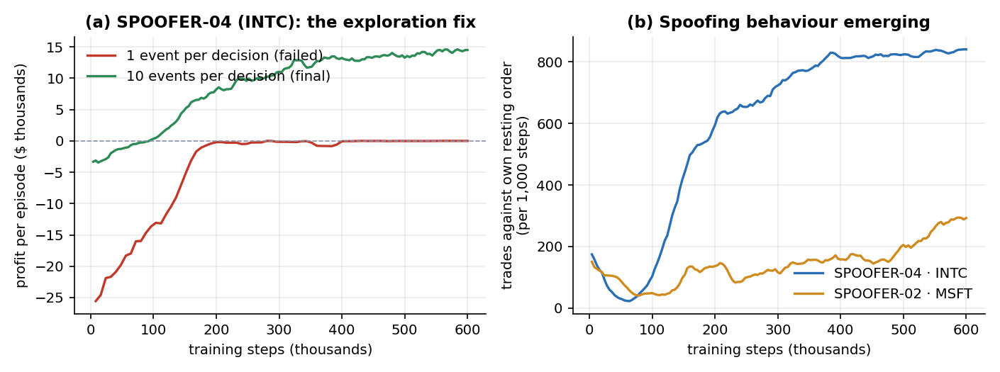
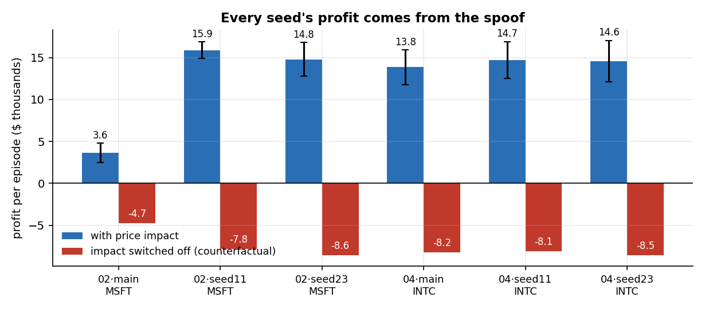
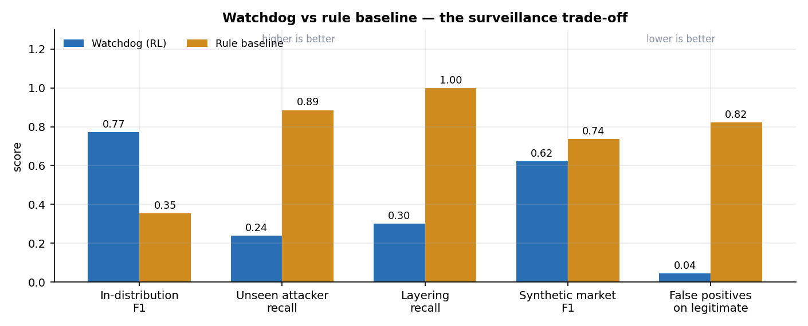
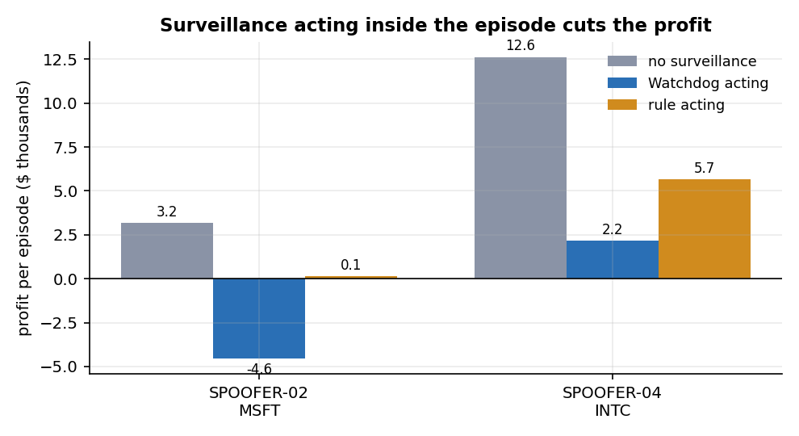
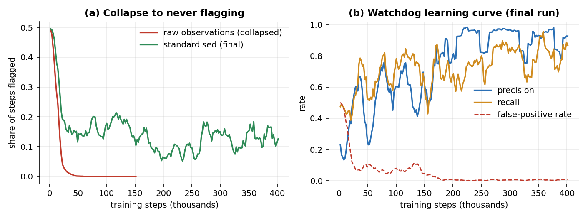
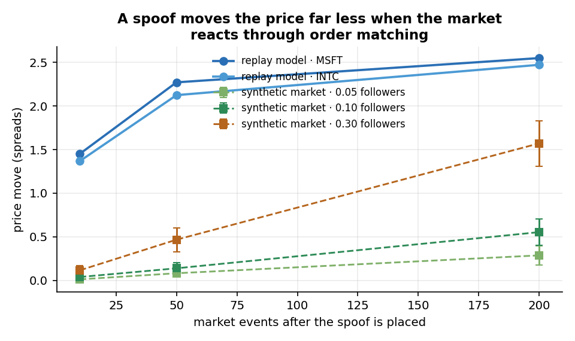

# An Adversarial Reinforcement Learning System for the Detection of Limit Order Book Spoofing

**Project report.** All figures and numbers in this report are generated from the committed code and results in
this repository (`results/`, `results/figures/`); none are illustrative. Every evaluation script has been
re-run in a clean clone and reproduces its reported values exactly (2,178 numeric values compared, 0 differences).

---

## Abstract

Market-surveillance systems in production are predominantly static rule sets. This project tests whether a
reinforcement-learning detector, trained adversarially against RL agents that discover manipulation on their
own, generalises better than such a rule. Using LOBSTER limit-order-book data for five NASDAQ stocks, a
population of PPO "Spoofer" agents was trained with no instruction to spoof — only to maximise profit — and a
recurrent "Watchdog" was trained to flag manipulation from order-flow observations, with no spoofing rule
supplied. Both were compared against a rule-based baseline (large order cancelled quickly) on identical data.

Spoofing emerged in agents trading the two narrow-spread stocks: profit of $14,368 ± 1,135 (INTC) and
$11,431 ± 16,844 (MSFT) per episode across three training seeds, which becomes a loss of $7–8k when the
price-impact model is disabled, confirming the profit comes from the manipulation itself. The Watchdog
achieved an order-level F1 of 0.753 ± 0.058 against the rule's 0.352, and a false-positive rate on legitimate
orders of 0.031 ± 0.067 against 0.823 — roughly 26× fewer false accusations. However, on two **pre-registered**
held-out attacks it recalled only 0.22 and 0.30 of manipulative orders where the rule recalled 0.89 and 1.00.

The central thesis — that an adaptive detector generalises better than a static rule — is therefore **not
supported for recall**, and **strongly supported for precision and false-positive cost**. A feature ablation
explains why: detection rests almost entirely on observing the agent trade against its own resting order, so
sparse manipulation evades it. A further sim-to-sim test found that the Spoofers' profitability does not
survive a market where prices emerge from order matching rather than from an impact model, which bounds the
scope of the first result.

---

## 1. Research question

> Can a reinforcement learning agent (the "Watchdog") learn to detect *previously unseen* order-book
> manipulation strategies — specifically spoofing — while maintaining a low false-positive rate on legitimate
> market activity, without being given explicit rules about what spoofing looks like?

This decomposes into three claims, each requiring evidence rather than assumption:

1. RL learns meaningful manipulation (not a reward-hacking artefact).
2. The Watchdog generalises to attacks it has not seen.
3. It does not simply flag legitimate activity.

**Scope statement, used verbatim throughout:** this project demonstrates the feasibility of an RL-based
surveillance approach in a realistic limit-order-book simulation, and evaluates the structural similarity of
the emergently-learned manipulation strategy to documented real-world manipulation cases. No labelled
real-world spoofing dataset exists, so **no claim of real-world detection capability is made**.

## 2. Background and legal grounding

Spoofing — "bidding or offering with the intent to cancel the bid or offer before execution" — is prohibited
under CEA §4c(a)(5)(C), added by §747 of the Dodd-Frank Act. CFTC guidance establishes that intent matters,
that a single occurrence can violate, and that context must be evaluated. Two design choices follow directly:
the Watchdog observes a window of history through a recurrent policy rather than classifying isolated
snapshots, and it is able to flag a single occurrence rather than requiring a repeated pattern.

Two enforcement actions provide the structural reference points used in §7: the CFTC order against Panther
Energy Trading and Michael Coscia (Docket 13-26, 2013) with the subsequent Seventh Circuit opinion, and the
CFTC's 2015 action against Navinder Sarao.

## 3. Method

### 3.1 Data

LOBSTER sample message and order-book files for 2012-06-21, ten levels deep: AAPL, MSFT, GOOG, INTC, AMZN
(400k–670k events each). The two stock types differ sharply, which matters for every result below: AAPL and
GOOG trade near $570–585 with 15–28 tick spreads and ~140 shares at the touch, while MSFT and INTC trade near
$27–30 with 1-tick spreads and ~13,500 shares at the touch.

### 3.2 Simulation environment

Historical replay cannot react to an injected order, so a price-impact layer is added. Its coefficient is
**fitted per stock from order-flow imbalance** (Cont, Kukanov & Stoikov, 2014) rather than assumed: regressing
mid-price change on signed order flow gives λ = 0.046 (AAPL) to 0.255 (MSFT), explaining 33–73% of variance.
A spoof's impact builds with the order's age following the measured response at 10/50/200/1000 events, and its
favourable price shift applies to at most its own size in opposite-side volume.

Cross-stock comparability required scale-free features: prices as offsets from mid in units of the stock's
trailing median spread, sizes as log ratios to trailing depth. In tick units the same book shape differs ~15×
between AAPL and INTC; in spread units both yield a median best-level offset of 0.500.

Agents act once per 10 market events, choosing among: no-op, market buy, market sell, place a large order at
the touch (10× trailing depth), or cancel. Inventory is valued at the **unimpacted** historical mid, so merely
holding a position while a spoof rests earns nothing; profit requires trading at the distorted price.

### 3.3 Agents

Five PPO Spoofers (256×256 MLP), one per stock, differing in inventory penalty and action constraints. The
Watchdog is a RecurrentPPO (LSTM) policy observing 46 features — 40 book features plus six describing the
monitored participant's own order activity — and choosing at each step to flag or clear. Its reward is
asymmetric, reflecting real surveillance economics: +1 correct flag, −1 miss, **−2 false accusation**, 0
correct clear. It is never shown the rule that defines the label.

The rule-based baseline flags any order at least N× trailing depth cancelled within M events without
executing, with N and M tuned on the training split — the same data the Watchdog trained on.

### 3.4 Evaluation protocol and safeguards

Four safeguards were adopted because early results proved untrustworthy (§6):

- **Pre-registration.** Two held-out attackers (LATEBURST-ATK, LAYER-ATK) had their behaviour, evaluation
  procedure and hypothesis committed to version control *before* any of their data existed, and each test was
  run exactly once. Both went against the Watchdog and are reported as such.
- **Counterfactual decomposition.** Every claim of manipulation profit is checked by re-running the identical
  policy with price impact disabled.
- **No tuning on held-out data.** One candidate design change was evaluated on the test split only, and
  rejected on that evidence.
- **Multiple seeds.** Three training seeds for the Watchdog and for each profitable Spoofer, with confidence
  intervals.

## 4. Result 1 — manipulation emerges, within limits

Spoofing was never rewarded directly; only profit was. In the two narrow-spread stocks the agents discovered
spoof-and-trade behaviour independently.

**Figure 1.** (a) At one decision per market event the agent converged to never trading: the ~50-event delay
between placing a spoof and profiting from it was 50 decisions away, and random early trading cost ~$13.6k per
episode, so inaction dominated. Acting once per 10 events solved the credit-assignment problem. (b) The
spoofing signature — trading against one's own resting order — emerging over training.

**Figure 2.** All three seeds for both stocks learned to spoof. Switching off price impact turns every seed's
profit into a $7–8.6k loss, establishing that the profit *is* the manipulation and not some other artefact.
INTC is stable across seeds ($14,368 ± 1,135); MSFT varies widely ($11,431 ± 16,844).

Spoofing did **not** emerge on AAPL, GOOG or AMZN. Under the calibrated impact, a spoof there moves the price
0.37–0.62 spreads — less than the half-spread cost of crossing — so it cannot pay. This is a property of those
markets under this model, not a training failure, but it does thin the agent population and leaves the held-out
RL test (AMZN) with no manipulation to detect.

## 5. Results 2 and 3 — the surveillance trade-off

**Figure 3.** Watchdog versus rule across every evaluation bucket.

| Measure | Watchdog | Rule | Source |
|---|---|---|---|
| In-distribution order F1 | **0.753 ± 0.058** | 0.352 | `multiseed.md` |
| False positives, legitimate orders | **0.031 ± 0.067** | 0.823 | `multiseed.md` |
| False positives, held-out stock | **0.004 ± 0.018** | 0.972 | `multiseed.md` |
| Recall, pre-registered unseen attacker | 0.217 ± 0.156 | **0.885** | `lateburst_test.md` |
| Recall, pre-registered layering attack | 0.30 | **1.00** | `layering_test.md` |
| Detection delay (median) | **0 steps** | 8 steps | `watchdog_eval.md` |

Two findings stand out.

**Claim 3 is supported decisively.** The Watchdog wrongly flags 3–7% of legitimate large orders where the rule
flags 82–97%. This is the difference between a usable surveillance system and an unusable one: at a 0.82
false-positive rate, every genuine alert arrives buried in false accusations against legitimate traders. The
rule's weakness is structural — large orders cancelled quickly are ordinary market-making behaviour. Its flag
rate on real, unlabelled order flow varies by a factor of 3,400 across stocks (0.03 per 10k events on MSFT,
101.9 on AMZN), confirming that one static threshold cannot serve different market structures.

**Claim 2 is not supported.** On both pre-registered attacks the rule recalls far more. The Watchdog also flags
*while the order still rests* (median delay 0 steps, against 8 for the rule, which can only fire at the
cancellation) — operationally valuable, since intervention is possible before the manipulation completes.

**Figure 4.** When the detector acts inside the episode — flagging triggers cancellation of the trader's
resting orders and a 200-event block — the Watchdog removes 83% of SPOOFER-04's profit against the rule's 55%,
and turns SPOOFER-02's profit into a loss. It intervenes against legitimate traders ~12× less often. Against
manipulation it recognises, the adaptive detector is both more effective and less disruptive.

## 6. Why the Watchdog fails, and what failed along the way

### 6.1 Interpretability

A feature-group ablation on the test split isolates the cause. Removing the single feature "did this
participant trade, and in which direction" collapses order-level F1 from 0.772 to **0.113** and step recall to
0.018. Removing all six participant features leaves nothing (F1 0.001), while removing all forty book features
*improves* F1 slightly.

The Watchdog therefore learned one specific signature: an agent trading repeatedly against its own resting
order. The dense MSFT/INTC Spoofers do this on almost every step. Sparse manipulators — a wait, then a few
trades — do not, and slip through. This is visible inside training too: SPOOFER-03 (GOOG) spoofs on 21% of its
test steps and is flagged on 1.8%.

### 6.2 Environment exploits found and closed

Headline profit was repeatedly misleading. Four exploits were caught only by decomposing where PnL came from:

| Exploit | Symptom | Fix |
|---|---|---|
| Free accumulation | Bought ~20× touch depth below the real bid; +$253k/episode | Charge the agent's own market orders price impact |
| Alternating-side swing | ±40-lot swings cost $53 while the spoof shift applied to unlimited volume; ~$240k/episode | Impact builds with order age; favourable shift capped at the spoof's size |
| Early termination | All 31 of 31 early endings occurred on a run-over step — an escape from losses | Lot scaled to depth; no early termination |
| Thin opening book | INTC depth 0.08× its median at event 15,000 | 30,000-event warmup |

### 6.3 Training collapses

**Figure 5.** The Watchdog initially collapsed to never flagging, at every entropy coefficient tried (0, 0.01,
0.03, 0.1). Early random flags land mostly on legitimate steps at −2 each, so silence (−0.13/step) dominates
before the features are learned. The cause was input scale: book features span ±20 while the informative
participant features span 0–5. Standardising observations fixed it; with raw inputs the collapse recurred even
at a milder −1 false-positive cost, confirming scale rather than reward asymmetry as the cause.

## 7. Structural comparison with documented cases

| Dimension | Coscia (court record) | SPOOFER-04 | Emergent or fixed by design |
|---|---|---|---|
| Large orders filled | 0.08% (CME), 0.5% (ICE) | 0.4% | Emergent |
| Large orders resting > 1 s | 0.57% | 52% | Emergent |
| Reversal after a cycle | "designed to promptly operate in reverse" | 74% of consecutive orders flip side | Emergent |
| Large vs small order size | 5 vs 50+ contracts | ~17–20× the trade lot | Fixed by the environment |

The learned strategy matches the documented pattern where the agent has freedom: large orders on one side
while trading the other, and almost never allowing the large order to fill. It differs in speed — the
calibrated impact ramp rewards patience, whereas Coscia's cycle completed in about two-thirds of a second —
and it cannot layer, because the environment permits one large order per side.

## 8. Robustness: does any of this survive a different market?

The replay environment imposes price impact by formula. As a sim-to-sim check, an agent-based market was built
in which prices emerge purely from order matching between noise traders and imbalance-following traders, and
calibrated against real MSFT/INTC statistics (spread, mid-change frequency, 2,000-event range, touch depth,
event mix) — never against spoof profitability.

**Figure 6.** A spoof does move the emergent price, with the same build-up shape and no formula involved — but
4.5–9× less than the replay model assumes, across the range of follower populations consistent with real price
dynamics.

Consequently **every manipulator loses money in the synthetic market**, including both RL Spoofers, and no
manipulation gain is clearly distinguishable from zero. Detection partially transfers: the Watchdog holds
precision 0.88 and a 0.11 false-positive rate against the rule's 0.92, but recall falls to 0.48.

This is the most important limitation in the project. Claim 1 holds under the replay impact model and not
beyond it. Which model is closer to reality is unresolved: the synthetic market's only reactive channel is
imbalance-following, with no market makers repricing quotes, so it is plausibly too inert — but that is a
hypothesis, not a defence.

## 9. Discussion

The headline finding is a trade-off rather than a victory, and it is a policy-relevant one. The static rule
catches nearly everything, including nearly everything innocent; the adaptive detector is precise, quiet, early,
and blind to manipulation structured differently from what it has seen. A real surveillance deployment cannot
use the rule as measured here — an 82% false-positive rate means investigating mostly legitimate traders — but
it cannot rely on this Watchdog alone either.

The ablation points to why, and to the likely fix: the detector keyed on a single behavioural signature
because the training population exhibited one dominant style. Training against a population deliberately
spanning sparse and dense manipulation is the natural next experiment, and is cheap relative to what has been
built.

Two methodological results are worth stating independently of the detector. First, **headline profit is not
evidence of learned manipulation** — four separate exploits produced large, plausible-looking profits, and each
was caught only by decomposing the PnL and running an impact-free counterfactual. Second, **pre-registration
changed the conclusions**: the earlier held-out attacker had been inspected during analysis and was no longer a
clean test, and both pre-registered replacements went against the hypothesis.

## 10. Limitations

- Profitable manipulation is established only under the replay impact model (§8).
- The detector misses sparse manipulation — the central negative result, confirmed twice under pre-registration.
- LOBSTER carries no participant identities, so the Watchdog cannot be evaluated on real order flow; only the
  rule can, and only as a flag *rate* with no labels.
- One trading day, five stocks, single-day calibration.
- The manipulation label is an economic proxy for intent (trading the opposite side while an order rests), not
  a legal determination.
- Layering can be scripted but not learned, as the environment allows one large order per side.
- Each non-profitable Spoofer remains single-seed.

## 11. Future work

1. Resolve whether the replay impact model is too generous or the synthetic market too inert — this decides the
   scope of claim 1.
2. Train the Watchdog against a population spanning sparse and dense manipulation styles, and re-run both
   pre-registered tests.
3. Extend the action space to multiple resting orders per side so layering can be learned rather than scripted.
4. Co-evolution (currently the Spoofer pool is frozen before Watchdog training) as a route to an adaptive
   adversary.

## 12. Reproducibility

All code, trained models, results and figures are committed. From a clean clone with the data downloaded, every
evaluation reproduces exactly: **2,178 numeric values compared across 12 scripts, 0 differences**, plus all 32
recorded dataset files bit-for-bit. The test suite is 139 tests against real market data. `HANDOFF.md`
documents the full procedure; `dashboard.html` presents the results interactively.

## References

1. Commodity Exchange Act §4c(a)(5)(C), as added by §747 of the Dodd-Frank Wall Street Reform and Consumer
   Protection Act (2010).
2. CFTC, *Antidisruptive Practices Authority* interpretive guidance, 78 Fed. Reg. 31890 (2013).
3. CFTC, *In re Panther Energy Trading LLC and Michael J. Coscia*, Docket 13-26 (22 July 2013).
4. *United States v. Coscia*, 866 F.3d 782 (7th Cir. 2017).
5. CFTC, *CFTC Charges U.K. Resident Navinder Singh Sarao … with Price Manipulation and Spoofing*, Release
   7156-15 (2015).
6. Cont, R., Kukanov, A. & Stoikov, S. (2014). The price impact of order book events. *Journal of Financial
   Econometrics*, 12(1), 47–88.
7. Huang, R. & Polak, T. (2011). LOBSTER: Limit Order Book Reconstruction System. Humboldt University Berlin.
8. Schulman, J. et al. (2017). Proximal Policy Optimization Algorithms. arXiv:1707.06347.
9. Raffin, A. et al. (2021). Stable-Baselines3: Reliable Reinforcement Learning Implementations. *JMLR*, 22(268).
