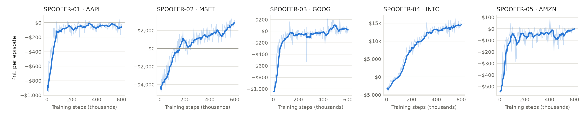
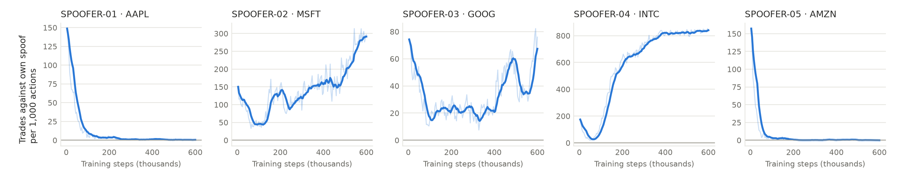
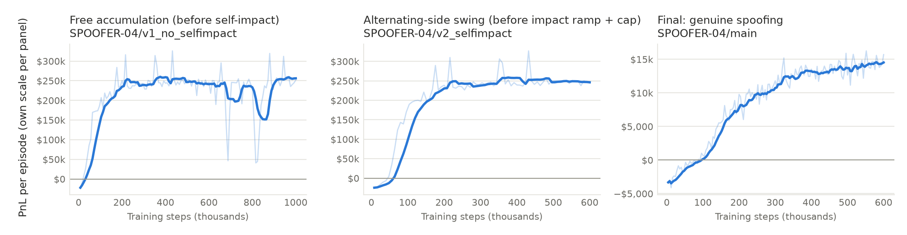

# Spoofer training and behaviour

Training curves (from the committed `progress.csv`, one row per 4,000 steps; light line raw, dark line 8-row rolling mean):

Earlier runs that found environment exploits, next to the final INTC run (each panel on its own scale; the exploit runs reached about $250k per episode):

## Behaviour of the final Spoofers (20 episodes each, sampled actions, fixed seeds)

Market events are the unit of time (10 per agent decision). Spoof size is fixed by design at 10× trailing touch depth at placement; the median below is its realised multiple.

| Spoofer | Stock | PnL / episode | Large orders / ep | Manipulative | Size × depth | Rest (events) median / p90 | Cancelled / run over / at end | Wait to first opposite trade (events) | Trades against own spoof / ep |
|---|---|---|---|---|---|---|---|---|---|
| SPOOFER-01 | AAPL | +42 | 53.2 | 0% | 10.0 | 10 / 30 | 99% / 0% / 1% | 10 | 0.2 |
| SPOOFER-02 | MSFT | +3,122 | 15.0 | 71% | 10.0 | 40 / 150 | 97% / 0% / 3% | 10 | 61.2 |
| SPOOFER-03 | GOOG | -12 | 22.8 | 29% | 10.0 | 20 / 70 | 97% / 2% / 2% | 10 | 14.4 |
| SPOOFER-04 | INTC | +15,311 | 13.7 | 95% | 10.0 | 130 / 247 | 92% / 1% / 7% | 10 | 171.4 |
| SPOOFER-05 | AMZN | -81 | 49.1 | 0% | 10.0 | 10 / 20 | 99% / 0% / 1% | n/a | 0.0 |

## Last 10% of training (rollout means from `progress.csv`)

| Spoofer | PnL / episode | Buy | Sell | Spoof buy | Spoof sell | Cancel | Trades against own spoof per 1k | Run-overs per 1k |
|---|---|---|---|---|---|---|---|---|
| SPOOFER-01 | -62 | 0.001 | 0.000 | 0.202 | 0.126 | 0.550 | 0.6 | 1.85 |
| SPOOFER-02 | +2,660 | 0.198 | 0.287 | 0.128 | 0.012 | 0.125 | 286.5 | 0.62 |
| SPOOFER-03 | +31 | 0.000 | 0.054 | 0.110 | 0.285 | 0.276 | 53.1 | 0.92 |
| SPOOFER-04 | +14,402 | 0.424 | 0.415 | 0.041 | 0.041 | 0.076 | 836.4 | 0.73 |
| SPOOFER-05 | -9 | 0.000 | 0.000 | 0.158 | 0.082 | 0.640 | 0.1 | 0.27 |
